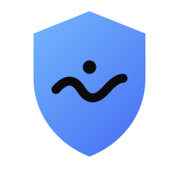
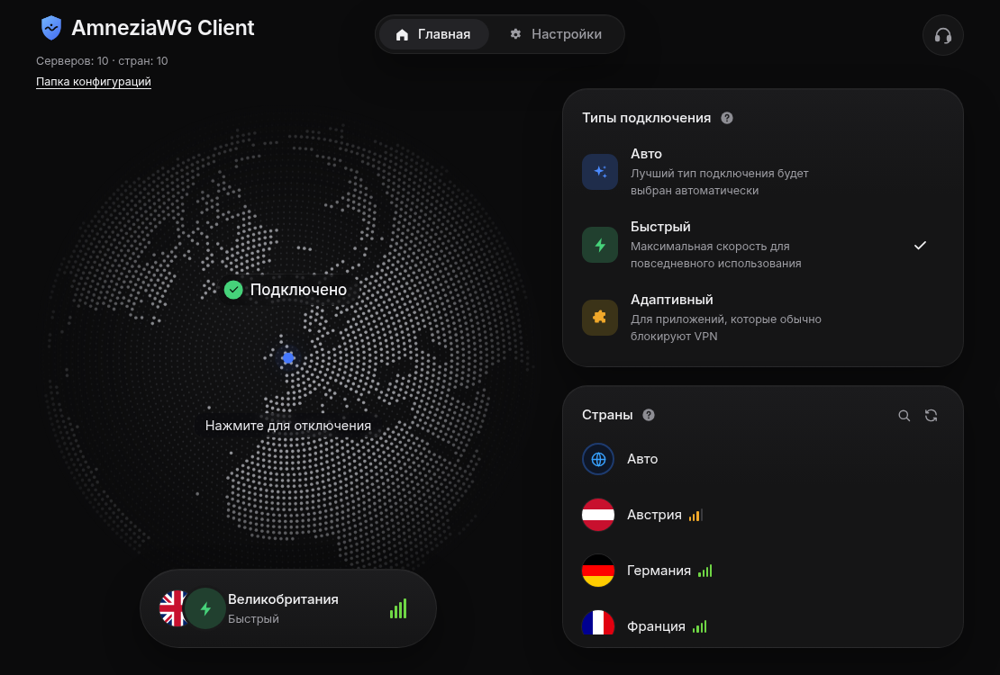
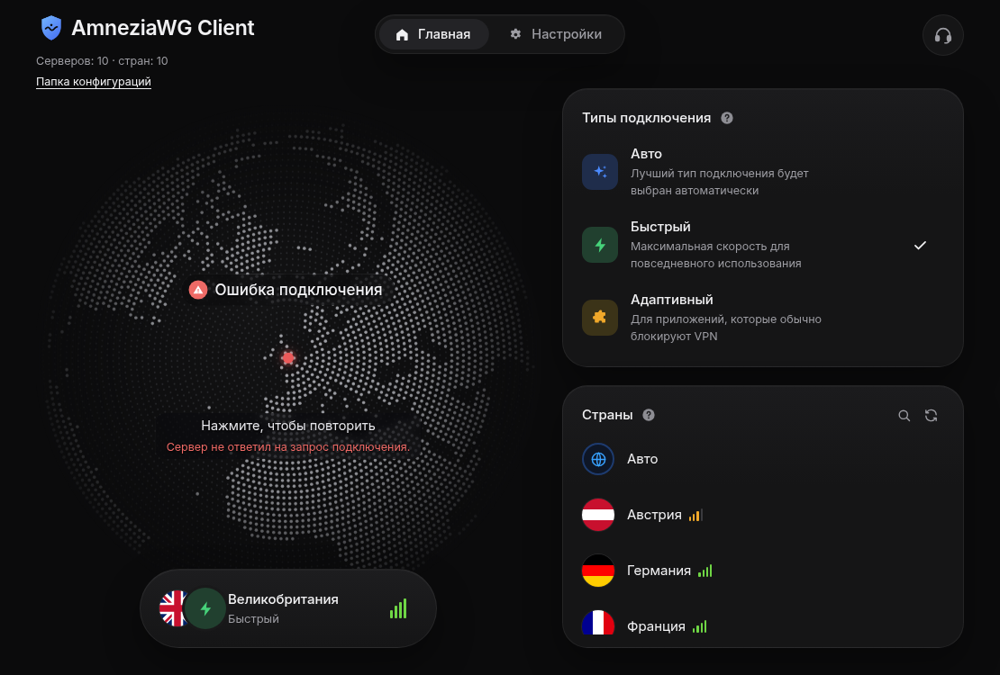
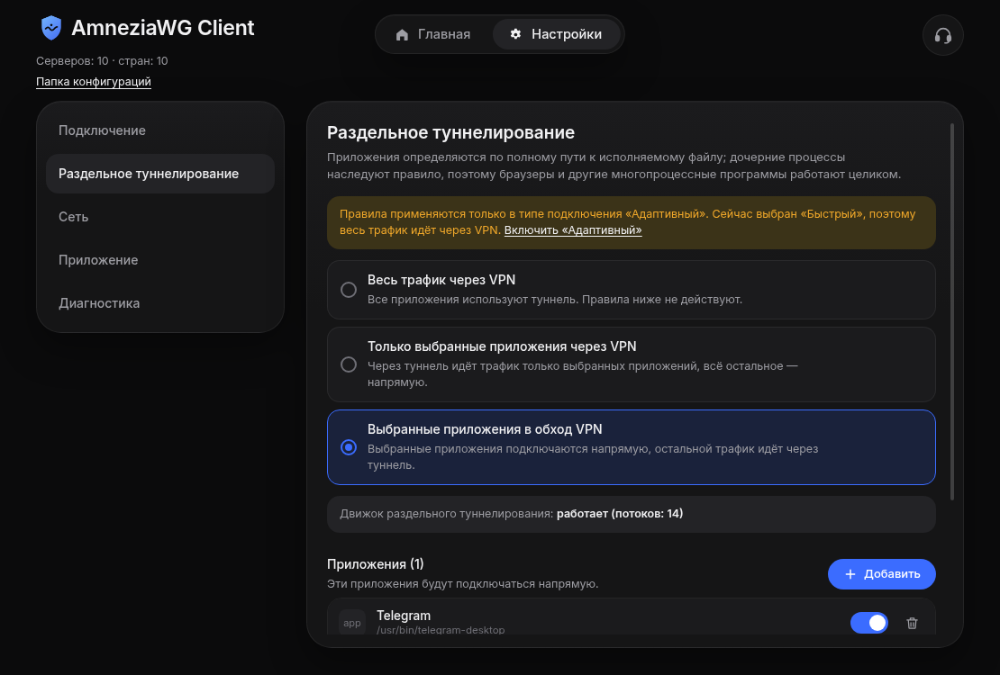
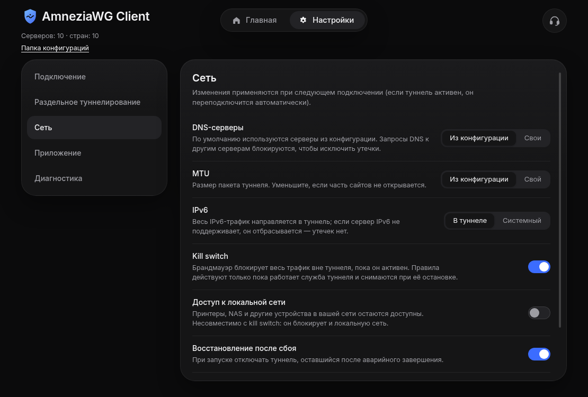
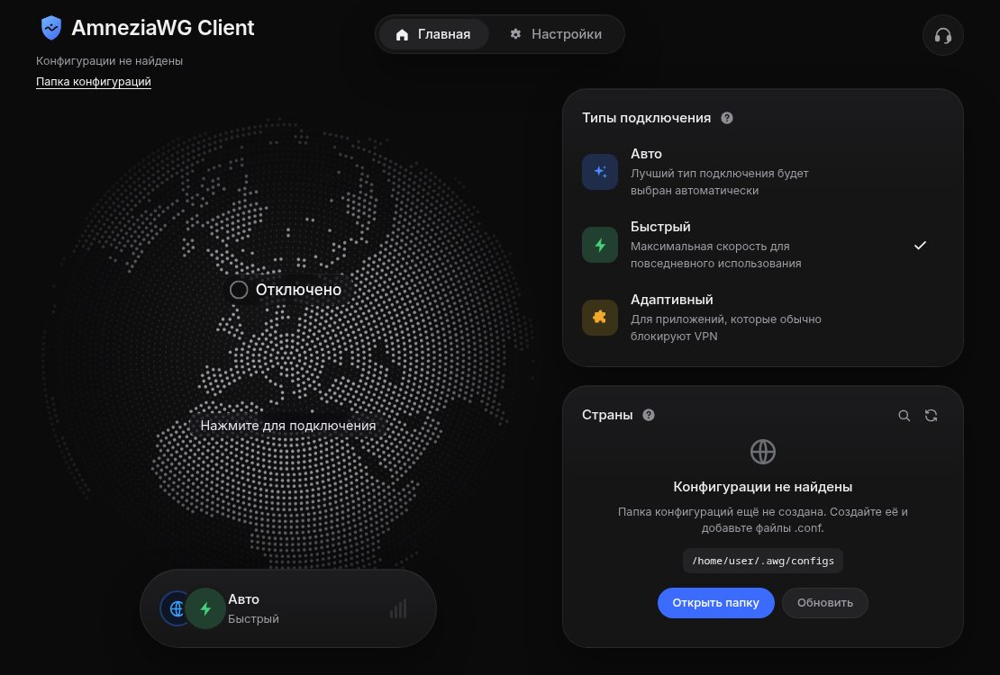
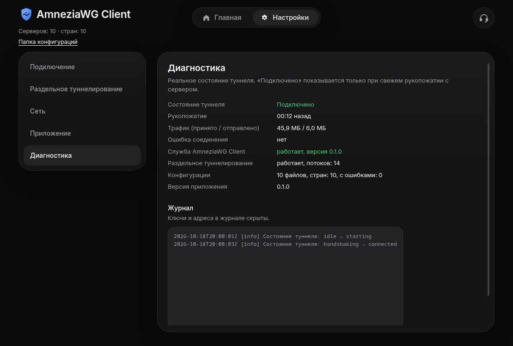

<div align="center">



# AmneziaWG Client

**Свободный десктопный клиент AmneziaWG 3.x для Linux и Windows**
**Free desktop client for AmneziaWG 3.x on Linux and Windows**

[🇷🇺 Русский](#-русский) · [🇬🇧 English](#-english) · [Лицензия / License](LICENSE)



</div>

---

# 🇷🇺 Русский

Клиент AmneziaWG 3.x с красивым интерфейсом: список стран строится из ваших `.conf`-файлов, подключение и состояние
показываются честно (по реальному рукопожатию), есть kill switch и раздельное туннелирование по приложениям.
Без аккаунтов, телеметрии, рекламы и облачного бэкенда — всё работает локально.

## Скриншоты

| Подключено | Ошибка подключения |
|---|---|
|  |  |
| **Раздельное туннелирование** | **Сеть** |
|  |  |
| **Пустое состояние (нет конфигураций)** | **Диагностика** |
|  |  |

## Возможности

- **Реальный туннель AmneziaWG 3.x:** `Jc/Jmin/Jmax`, `S1–S4`, `H1–H4` (диапазоны), `I1–I5`, `HeaderProtectionKey`,
  `ContentPaddingAddition`, `Rekey*`, `RejectAfterTime`, `KeepaliveTimeout`, `MaxHandshakeAttempts` и др.
  Под капотом — официальные `amneziawg-go` / `amneziawg-tools` (Linux) и `amneziawg-windows` (Windows).
- **Честное состояние:** «Подключено» показывается только после свежего рукопожатия с сервером.
- **Страны из файлов:** `Japan.conf` → «🇯🇵 Япония». Регистр, пробелы/`_`/`-`, коды ISO, псевдонимы (UK, USA…), Unicode-имена,
  суффиксы серверов (`Germany-2.conf`), дубликаты, неизвестные названия — всё обрабатывается. Список не зашит в код.
- **Папка конфигураций:** по умолчанию `~/.awg/configs/` (Linux), настраивается; изменения подхватываются автоматически.
- **Типы подключения:** Авто (лучший по измеренной задержке + переход к следующему при неудаче), Быстрый, Адаптивный.
  Задержка измеряется обычным ICMP-ping **без подключения к VPN**; если ping не отвечает — показывается «не измерено».
- **Kill switch** (nftables на Linux, WFP на Windows), доступ к локальной сети, свои DNS и MTU, подгонка MSS, мгновенный отказ IPv6 в туннеле.
- **Раздельное туннелирование по приложениям** (см. ограничения ниже), переподключение при потере связи и после сна.
- Тёмная/светлая тема, трей, уведомления, диагностика с маскированием секретов.

## Платформы и статус проверки

| | Linux | Windows |
|---|---|---|
| Туннель AmneziaWG 3.x, рукопожатие, трафик | ✅ проверено сквозным тестом (изолированные сетевые пространства имён) и на реальном сервере | ⚠️ собрано, **не проверялось** на Windows |
| Kill switch, отказ при аварии туннеля, чистое отключение | ✅ сквозной тест | ⚠️ не проверялось |
| Раздельное туннелирование | ✅ работает (проверено на реальной системе); учтите: переключаются соединения, **открытые после** переноса процесса в cgroup | ⚠️ не проверялось (WinDivert) |
| Установщик / AppImage | ✅ AppImage собирается и запускается | ⚠️ NSIS и portable собираются, не проверялись |

## Установка (Linux)

Нужны пакеты `amneziawg-tools`, `amneziawg-go` (или модуль ядра `amneziawg`), `iproute2`, `nftables`, `polkit`.

```bash
chmod +x AmneziaWGClient-*.AppImage && ./AmneziaWGClient-*.AppImage
```

Положите `.conf` в `~/.awg/configs/`. При первом подключении нажмите **«Запустить службу»** — привилегированная часть
(`awg-helper`) запускается через `pkexec` (запрос пароля системой) и завершается вместе с приложением.

> ⚠️ Если на системе включён прокси (Happ/X-Ray, переменные `HTTP_PROXY`, настройки KDE/GNOME), приложения вроде Claude Desktop
> продолжат ходить через него. Отключите системный прокси, если хотите пользоваться только туннелем.

## Сборка из исходников

Node.js 20+, Go 1.25+.

```bash
npm install
npm run helper:build      # Go-служба (go test + сборка; Windows: helper/bin/awg-helper.exe)
npm run native:fetch      # (Windows) wintun.dll и WinDivert с проверкой SHA-256
npm run build             # electron-vite
npx electron-builder --linux AppImage   # или: npm run dist (Windows)
npm run dev               # запуск из исходников
```

Проверки: `npm run typecheck`, `npm test`, `npm run helper:test`; сквозной тест Linux без root:
`unshare -r -n -m python3 scripts/e2e_linux.py helper/bin/linux/awg-helper`.
Предпросмотр интерфейса в браузере (макет данных): `npm run ui:preview`; обновить скриншоты: `scripts/screenshots.cjs`.

## Архитектура и безопасность

```
Electron (renderer: sandbox, contextIsolation) ── узкий preload-мост ──▶ Electron main
        │ (Unix-сокет /run/privata-vpn/helper.sock или именованный канал Windows, JSON, проверка SO_PEERCRED/DACL)
        ▼
awg-helper (root / SYSTEM): проверка запроса и конфигурации → awg-quick (Linux) / amneziawg-windows (Windows)
        → kill switch, раздельное туннелирование, мониторинг рукопожатия
```

- Приложение работает без повышенных прав; привилегированная часть принимает только фиксированный набор операций и не принимает пути и команды.
- Скрипты `PreUp/PostUp/PreDown/PostDown` в конфигурациях отклоняются; секреты не попадают в журналы и в renderer.
- Нет телеметрии и внешних серверов; единственная сеть — туннель и ICMP-ping до серверов из ваших конфигураций.

## Раздельное туннелирование — как работает и ограничения

- **Linux:** выбранные приложения (и их потомки) переносятся в cgroup v2; правила nftables помечают их пакеты, политика маршрутизации
  направляет их через физический интерфейс (masquerade). Режимы: «в обход VPN» и «только выбранные через VPN».
  **Ограничение ядра:** сокет привязывается к cgroup при создании, поэтому уже открытые соединения процесса не переключаются —
  работают соединения, открытые после переноса. Работоспособность подтверждена на реальной системе; автоматический сквозной тест
  в изолированных пространствах имён этот режим пока проверяет не полностью.
- **Windows:** перехват пакетов WinDivert (только IPv4 TCP/UDP), не проверено на живой системе.

## Благодарности и происхождение дизайна

- **Дизайн интерфейса вдохновлён и основан на макете клиента Privata VPN** (композиция, карточки, глобус,
  режимы подключения). Это независимый проект: **не связан с Privata VPN и Amnezia**, названия и торговые марки принадлежат их владельцам.
  Логотип и код — собственные.
- Протокол и реализации: [AmneziaWG](https://amnezia.org/), [amneziawg-go](https://github.com/amnezia-vpn/amneziawg-go),
  [amneziawg-tools](https://github.com/amnezia-vpn/amneziawg-tools), [amneziawg-windows](https://github.com/amnezia-vpn/amneziawg-windows).
- [Wintun](https://www.wintun.net/), [WinDivert](https://reqrypt.org/windivert.html), [flag-icons](https://github.com/lipis/flag-icons),
  [Natural Earth](https://www.naturalearthdata.com/) — см. [THIRD_PARTY_NOTICES.md](THIRD_PARTY_NOTICES.md).

## Лицензия

MIT для оригинального кода — [LICENSE](LICENSE). Сторонние компоненты сохраняют собственные лицензии.

---

# 🇬🇧 English

A desktop client for AmneziaWG 3.x with a polished UI: the country list is built from your `.conf` files, the connection state
reflects the **real handshake**, and it ships with a kill switch and per-application split tunneling.
No accounts, telemetry, ads or cloud backend — everything runs locally.

## Screenshots

See the [screenshots above](#скриншоты) (Connected, Connection error, Split tunneling, Network, Empty state, Diagnostics).

## Features

- **Real AmneziaWG 3.x tunnel**: `Jc/Jmin/Jmax`, `S1–S4`, `H1–H4` (ranges), `I1–I5`, `HeaderProtectionKey`, `ContentPaddingAddition`,
  `Rekey*`, `RejectAfterTime`, `KeepaliveTimeout`, `MaxHandshakeAttempts`, … Powered by the official `amneziawg-go` /
  `amneziawg-tools` (Linux) and `amneziawg-windows` (Windows).
- **Honest state**: "Connected" is shown only after a fresh handshake with the server.
- **Countries come from files**: `Japan.conf` → "🇯🇵 Japan". Case/space/`_`/`-`, ISO codes, aliases (UK, USA…), Unicode file names,
  server suffixes (`Germany-2.conf`), duplicates and unknown names are handled. Nothing is hard-coded.
- **Config folder**: `~/.awg/configs/` by default on Linux (configurable), watched for changes.
- **Connection types**: Auto (best measured latency, falls back to the next server), Fast, Adaptive (applies split-tunnel rules).
  Latency is measured with plain ICMP ping **without connecting**; if ping gets no reply the UI says "not measured".
- **Kill switch** (nftables on Linux, WFP on Windows), LAN access, custom DNS/MTU, MSS clamping, instant IPv6 reject inside the tunnel.
- **Per-application split tunneling** (see limitations), auto-reconnect on loss and after resume.
- Dark/light theme, tray, notifications, diagnostics with secret redaction. The UI language is Russian.

## Platforms and verification status

| | Linux | Windows |
|---|---|---|
| AmneziaWG 3.x tunnel, handshake, traffic | ✅ verified by an end-to-end test (isolated network namespaces) and on a real server | ⚠️ builds, **not tested** on Windows |
| Kill switch, fail-closed on tunnel crash, clean disconnect | ✅ end-to-end test | ⚠️ not tested |
| Split tunneling | ✅ works (verified on a real system); note: connections **opened after** the process is moved into the cgroup are redirected | ⚠️ not tested (WinDivert) |
| Installer / AppImage | ✅ AppImage builds and starts | ⚠️ NSIS and portable build, untested |

## Install (Linux)

Requires `amneziawg-tools`, `amneziawg-go` (or the `amneziawg` kernel module), `iproute2`, `nftables`, `polkit`.

```bash
chmod +x AmneziaWGClient-*.AppImage && ./AmneziaWGClient-*.AppImage
```

Put your `.conf` files into `~/.awg/configs/`. On first connect click **"Запустить службу" (Start service)**: the privileged part
(`awg-helper`) is started through `pkexec` (system password prompt) and exits with the app.

> ⚠️ If a system proxy is configured (Happ/X-Ray, `HTTP_PROXY`, KDE/GNOME settings), apps such as Claude Desktop keep using it.
> Disable the system proxy if you want them to go through the tunnel only.

## Build from source

Node.js 20+, Go 1.25+.

```bash
npm install
npm run helper:build      # Go service (go test + build; Windows: helper/bin/awg-helper.exe)
npm run native:fetch      # (Windows) wintun.dll and WinDivert, SHA-256 verified
npm run build             # electron-vite
npx electron-builder --linux AppImage   # or: npm run dist (Windows)
npm run dev               # run from sources
```

Checks: `npm run typecheck`, `npm test`, `npm run helper:test`; rootless Linux end-to-end test:
`unshare -r -n -m python3 scripts/e2e_linux.py helper/bin/linux/awg-helper`.
UI preview in a browser (mock data): `npm run ui:preview`; regenerate screenshots: `scripts/screenshots.cjs`.

## Architecture and security

- The app runs unprivileged; the privileged helper accepts a fixed set of operations over a Unix socket (peer-credential check) /
  Windows named pipe (DACL) and never accepts paths or commands.
- `PreUp/PostUp/PreDown/PostDown` scripts in configs are rejected; secrets never reach logs or the renderer.
- No telemetry and no external servers; the only network activity is the tunnel and ICMP pings to servers from your configs.

## Split tunneling — how it works and limits

- **Linux**: selected apps (and their children) are moved into a cgroup v2; nftables marks their packets and policy routing sends them
  out of the physical interface (masquerade). Modes: "bypass VPN" and "only selected through VPN". **Kernel limitation:** a socket is
  bound to its cgroup at creation time, so already-open connections of a process are not switched. Verified working on a real
  system; the automated end-to-end test in isolated network namespaces does not fully cover this mode yet.
- **Windows**: WinDivert packet interception (IPv4 TCP/UDP only), untested on a live system.

## Credits and design origin

- **The UI design is inspired by and based on a mock-up of the Privata VPN client** (layout, cards, globe,
  connection types). This is an independent project **not affiliated with Privata VPN or Amnezia**; names and trademarks belong to their owners.
  The logo and the code are original.
- Protocol and implementations: [AmneziaWG](https://amnezia.org/), [amneziawg-go](https://github.com/amnezia-vpn/amneziawg-go),
  [amneziawg-tools](https://github.com/amnezia-vpn/amneziawg-tools), [amneziawg-windows](https://github.com/amnezia-vpn/amneziawg-windows).
- [Wintun](https://www.wintun.net/), [WinDivert](https://reqrypt.org/windivert.html), [flag-icons](https://github.com/lipis/flag-icons),
  [Natural Earth](https://www.naturalearthdata.com/) — see [THIRD_PARTY_NOTICES.md](THIRD_PARTY_NOTICES.md).

## License

MIT for the original code — [LICENSE](LICENSE). Third-party components keep their own licenses.
